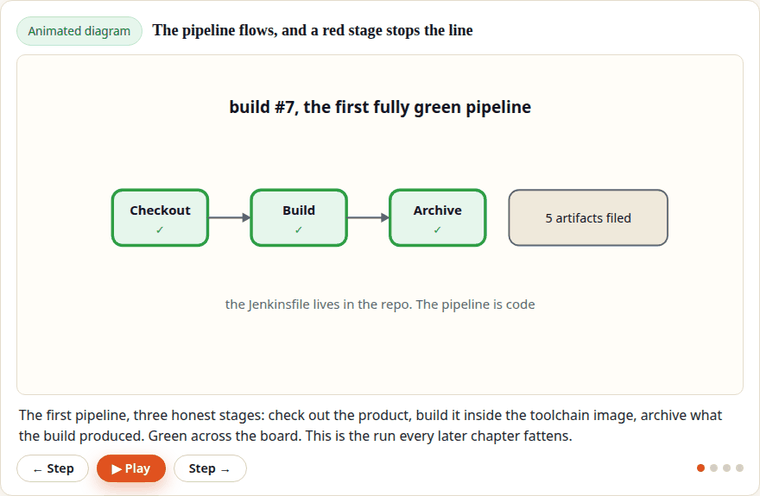

# Occupancy Sensor — Product Repo (Embedded DevOps, Engineered)

*One of the course's animated lesson diagrams (not a recording of a live run):
the delivery pipeline from Chapter 5, stepped through frame by frame —
including the moment a broken commit turns a stage red and stops the line.*

## Start here

**The full guided project lives at [Bit to Board](https://bittoboard.com/embedded-devops/)** —
this repository is its companion code, public so you can inspect exactly what
you will build before deciding anything. Bit to Board is project-based
learning: you learn embedded systems by building real projects end to end.

- **The project:** [Embedded DevOps, Engineered](https://bittoboard.com/embedded-devops/) — the guided build this repo belongs to.
- **The firmware's own course:** [Zigbee, Engineered](https://bittoboard.com/zigbee-engineered/), with its code in [zigbee-engineered](https://github.com/learnbittoboard/zigbee-engineered).
- **Free, in full:** the [Guides](https://bittoboard.com/guides/) — full-depth procedures in the same style as the lessons.
- **New releases and posts:** the [Bit to Board newsletter](https://bittoboard.com/newsletter/) — one email when there is something worth saying.

## What this repo is

The finished Course 1 product — the Zigbee occupancy-sensor firmware for the
nRF52840 DK (HLK-LD2410 mmWave sensor, MCUboot-signed images, `.zigbee` OTA
packages) — plus the delivery factory this course builds around it:

| Path | What it is | Chapter |
|---|---|---|
| `app/` | The firmware (sysbuild app: app + MCUboot images) | Course 1 |
| `Dockerfile` | The pinned toolchain image definition | 2–3 |
| `docker-compose.yml` | Jenkins, stood up as code | 4 |
| `Jenkinsfile` | The pipeline: build → gates → sign → release | 5–9 |
| `app/tests/` | Host unit tests (ztest/Twister) for the frame parser | 6 |
| `tools/` | Manifest generator, release helpers | 7, 9 |
| `tests/hil/` | Hardware-in-the-loop smoke suite (pytest + pyserial) | 10 |
| `.github/workflows/` | The same pipeline in GitHub Actions | 11 |

The git history is the course: one commit per chapter, tagged `ch01`…`ch11`.
Check out any tag to see the repo exactly as that chapter leaves it.
